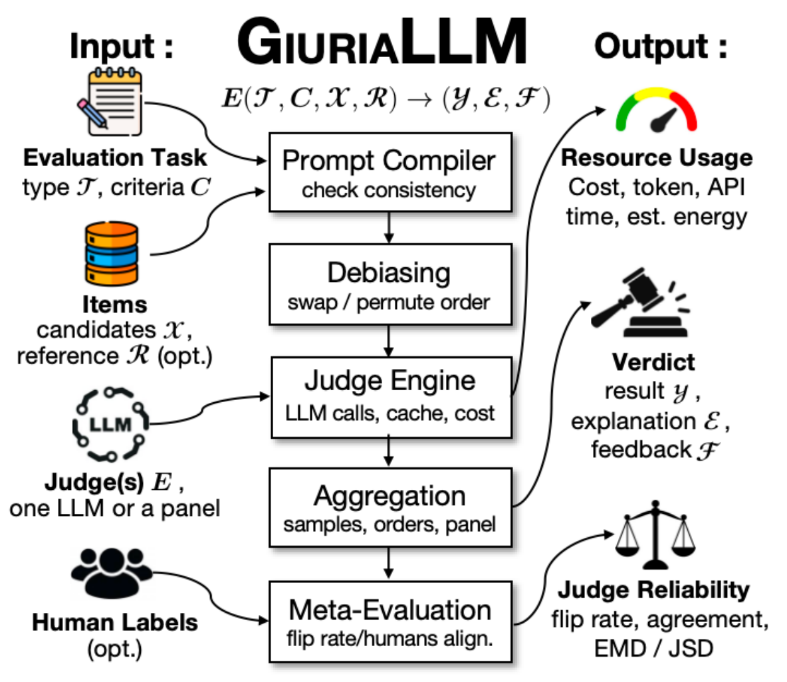

# GiuriaLLM

GiuriaLLM is a configurable LLM-as-a-judge framework for software engineering. It evaluates software artifacts using one LLM or a panel, with tasks, criteria, models, and input data defined in YAML. It supports pointwise scoring, pairwise comparison, and listwise ranking or selection, and reports verdicts and resource use. To assess judge reliability, it measures how often verdicts change when candidates are reordered. When human annotations are available, it compares judge and human label distributions and reports results by human agreement. Supported providers include Anthropic, OpenAI, OpenAI-compatible endpoints, and local models served by Ollama.

<p align="center">
  
</p>

## Quick start with Docker

This example uses OpenAI's `gpt-5.4-mini` to evaluate one patch from APR-Assess. The image includes the configuration and input data. You need Docker and an OpenAI API key.

```bash
mkdir -p runs
export OPENAI_API_KEY="your-api-key"
docker run --rm --user "$(id -u):$(id -g)" \
  -e OPENAI_API_KEY -v "$PWD/runs:/work/runs" \
  ghcr.io/uoa-hasel/giuriallm:latest \
  run /opt/giuriallm/demo/configs/apr-patch.yaml
```

The input contains the bug context, a candidate patch, and a correct reference patch. The model scores the patch as 0 or 1, and GiuriaLLM compares its verdict with five human annotations. The report appears in the terminal, and output files are saved under `runs/`. API usage is billed to your OpenAI account.

For an installation check without an API key:

```bash
mkdir -p runs
docker run --rm --user "$(id -u):$(id -g)" \
  -v "$PWD/runs:/work/runs" \
  ghcr.io/uoa-hasel/giuriallm:latest \
  run /opt/giuriallm/examples/code-gen-pairwise.yaml --provider mock --no-cache
```

Mock verdicts are test data. These commands use a POSIX shell. The [usage guide](docs/usage.md) covers YAML configuration, panels, custom endpoints, PowerShell, and the Python API. Versioned image tags are published with GitHub releases.

## Results

Each run writes a timestamped directory:


| File                        | Contents                                        |
| --------------------------- | ----------------------------------------------- |
| `report.md` / `console.txt` | Evaluation and resource-use report              |
| `results.json`              | Summary metrics and each item's final result    |
| `judgements.jsonl`          | Individual model judgements, including failures |
| `config.yaml`               | Resolved run configuration                      |
| `manifest.json`             | Run metadata, fingerprints, and resource totals |


Reports show each judge and, when configured, the panel. Resource tables report tokens, estimated cost, cumulative API time, and estimated energy per input item.

Use `giuriallm show RUN_DIR` to read saved results and `giuriallm summarize RUN_DIR...` to combine repeated runs. Neither command calls a model. See [reports and metrics](docs/usage.md#reports-and-metrics) for definitions.

## Examples and paper data


| Configuration                                             | Purpose                                                   |
| --------------------------------------------------------- | --------------------------------------------------------- |
| [APR pointwise](demo/configs/apr-patch.yaml)              | Evaluate one patch with OpenAI                            |
| [APR five-judge panel](demo/configs/apr-five-judges.yaml) | Original configuration used in the paper demo             |
| [Pairwise](examples/code-gen-pairwise.yaml)               | Compare two implementations and measure order sensitivity |
| [Listwise](examples/code-gen-listwise.yaml)               | Rank three implementations across candidate permutations  |


Both APR configurations use the same [patch input](demo/data/apr-patch.jsonl) and [human annotations](demo/data/human-labels.jsonl). The original five-judge configuration uses AiHubMix. To run it with Docker, use the quick-start command with `AIHUBMIX_API_KEY` and `apr-five-judges.yaml` in place of `OPENAI_API_KEY` and `apr-patch.yaml`.

In the recorded five-judge run, three judges were correct, two were incorrect, and the panel's majority verdict was correct. New runs may differ. The single-judge quick start does not reproduce that panel setup.

The [Zenodo archive](https://zenodo.org/records/23584777) contains the evaluation data, recorded demo, and experiment results. See [paper experiments](experiments/README.md) for configurations and reproduction commands.

## Local installation

Requires Python 3.11 or newer. From a POSIX shell:

```bash
git clone https://github.com/UoA-HASEL/GiuriaLLM.git
cd GiuriaLLM
python -m venv .venv
source .venv/bin/activate
pip install -r requirements.txt
pip install -e .
export OPENAI_API_KEY="your-api-key"
giuriallm validate demo/configs/apr-patch.yaml --check-dataset
giuriallm run demo/configs/apr-patch.yaml
```

For development, install `pip install -e ".[dev]"`, then run `pytest` and `ruff check src tests`. To build a local image, run `docker build -t giuriallm:local .`.

## Paper and authors

**GIURIALLM: A Configurable LLM-as-a-Judge Framework for Software Engineering**

Yeheng Chen and Valerio Terragni, University of Auckland.

Under review at the ICSE 2027 Tool Demonstration and Data Showcase Track.

## License

GiuriaLLM is released under the [Apache License 2.0](LICENSE). Benchmark data retain their original licenses.
